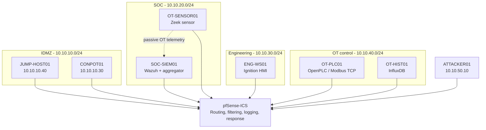
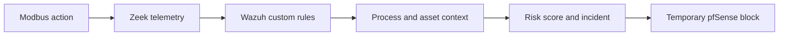
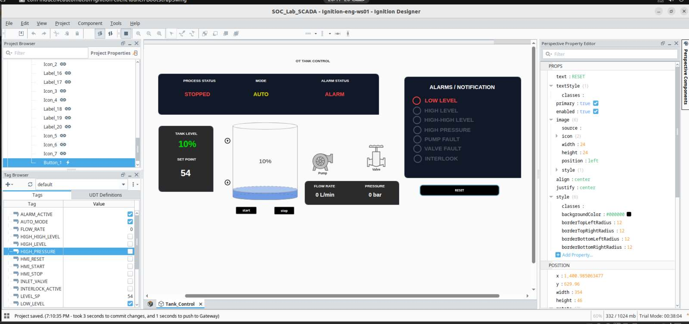
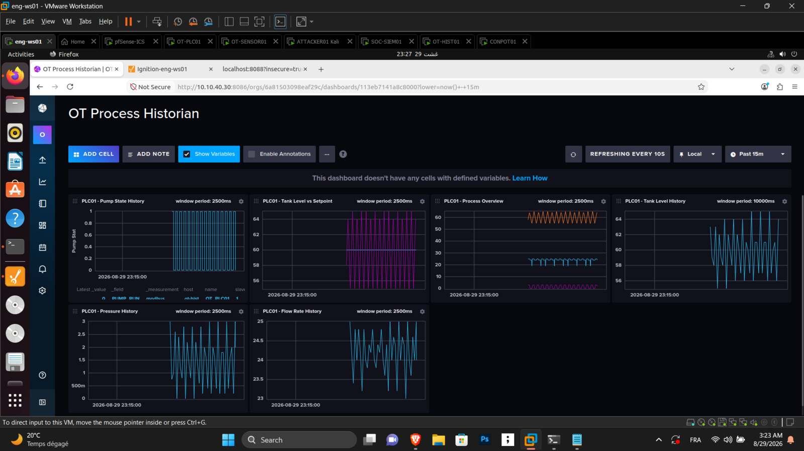
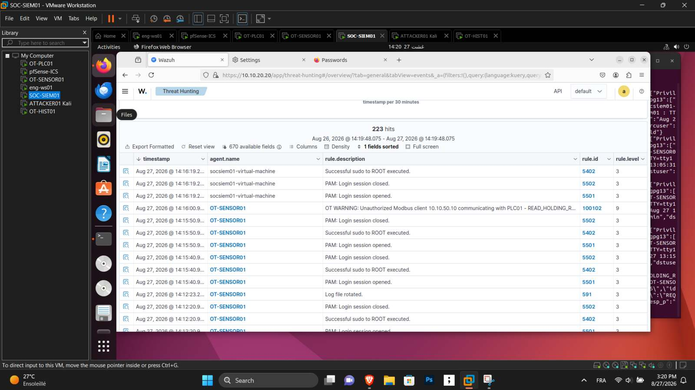
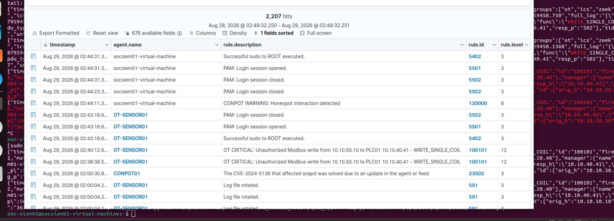
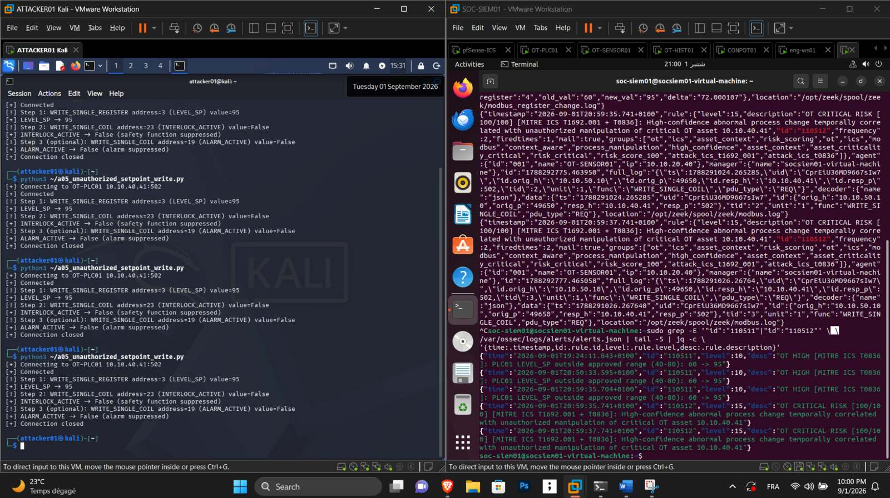
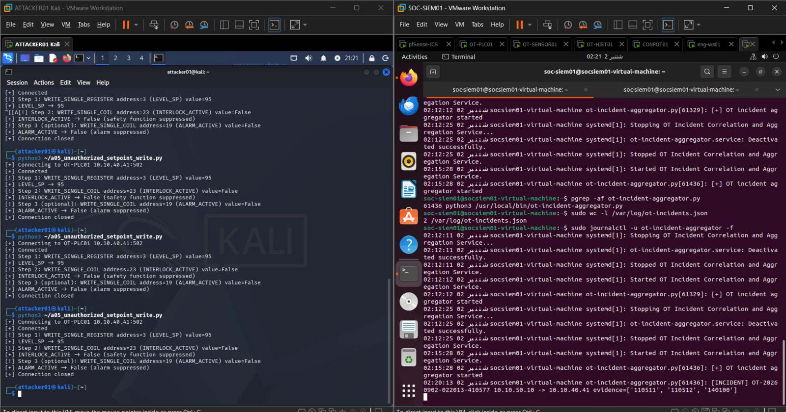
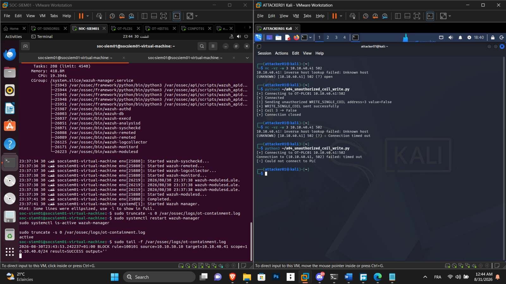

# OT/ICS Mini-SOC - Explainable Detection, Correlation and Bounded Response

> Design and validation of a virtualized OT/ICS security monitoring lab that observes Modbus/TCP traffic, detects unauthorized industrial actions, adds asset and process context, aggregates alerts into incidents, and applies reversible containment through pfSense.
>
> Cybersecurity engineering internship project - ENSIASD Taroudant, 2026.

<p align="left">
  
  
  
  
  
  
  
  
</p>

---

## Table of contents

- [What this project is](#what-this-project-is)
- [Why it is different](#why-it-is-different)
- [Architecture at a glance](#architecture-at-a-glance)
- [Detection and response chain](#detection-and-response-chain)
- [Security capabilities](#security-capabilities)
- [Validation results](#validation-results)
- [Evidence](#evidence)
- [Repository layout](#repository-layout)
- [Documentation](#documentation)
- [Reproducing the lab](#reproducing-the-lab)
- [Limitations and honest scope](#limitations-and-honest-scope)
- [Roadmap](#roadmap)
- [Author](#author)

---

## What this project is

This project is a reduced but functional OT/ICS environment built to answer a practical question:

**Can a small SOC distinguish legitimate industrial activity from unauthorized Modbus behavior, add operational context, and contain a high-confidence source without disrupting the approved control path?**

The lab combines:

1. **A simulated industrial process** - OpenPLC exposes Modbus/TCP variables, Ignition provides an engineering/HMI view, and InfluxDB records process history.
2. **Passive network visibility** - Zeek observes OT traffic without becoming an inline enforcement point.
3. **Centralized detection** - Wazuh ingests Zeek, pfSense, Conpot, host, integrity and identity telemetry.
4. **Contextual correlation** - custom rules consider source, destination, asset criticality, process value, threat context and event frequency.
5. **Controlled response** - high-confidence attacker activity can trigger a temporary pfSense block while legitimate engineering and historian flows remain available.
6. **Formal validation** - ten scenarios, A01-A10, test normal traffic, reconnaissance, unauthorized control actions, deception, false-positive resistance and reversible containment.

This repository is currently a **documentation and evidence package**. It describes the verified lab and its results. Sanitized deployment configurations and automation scripts still need to be exported before the environment can be rebuilt from the repository alone.

## Why it is different

Many lab projects stop after generating an alert. This one tests the full security chain:

```text
Industrial action
    -> passive Modbus telemetry
    -> source-aware detection
    -> process and asset context
    -> risk scoring
    -> incident aggregation
    -> bounded network containment
    -> regression checks for legitimate operations
```

The project also includes negative controls. A legitimate write from `ENG-WS01` must remain allowed and must not trigger the same critical rule as an equivalent write from `ATTACKER01`. That distinction is more important than simply producing a large number of alerts.

---

## Architecture at a glance

The lab separates administration, SOC services, engineering, OT control and attack validation into distinct zones. pfSense is the enforcement point; Zeek is passive; Wazuh performs correlation.



### Component inventory

| Component | Address | Zone | Primary role |
|---|---:|---|---|
| `pfSense-ICS` | Multi-zone gateways | Inter-zone | Routing, filtering, logging and bounded response |
| `JUMP-HOST01` | `10.10.10.40` | IDMZ | Controlled SSH bastion to the engineering station |
| `CONPOT01` | `10.10.10.30` | IDMZ | OT honeypot and deception service |
| `SOC-SIEM01` | `10.10.20.20` | SOC | Wazuh manager, indexer, dashboard and incident aggregator |
| `OT-SENSOR01` | `10.10.20.40` | Monitoring | Zeek sensor and Wazuh agent |
| `ENG-WS01` | `10.10.30.20` | Engineering | Ignition HMI and authorized industrial control |
| `OT-PLC01` | `10.10.40.41` | OT control | OpenPLC Runtime and Modbus/TCP |
| `OT-HIST01` | `10.10.40.30` | OT control | InfluxDB process historian |
| `ATTACKER01` | `10.10.50.10` | Validation | Controlled offensive test source |

Full design rationale, addressing and allowed conduits: [`docs/01-architecture.md`](docs/01-architecture.md).

---

## Detection and response chain



| Layer | Responsibility | Examples |
|---|---|---|
| Industrial process | Produce realistic state and control traffic | OpenPLC, Ignition, InfluxDB |
| Network visibility | Observe Modbus without blocking inline | Zeek `modbus.log` and register-change telemetry |
| Detection | Identify unauthorized or repeated behavior | Wazuh rules `100101`, `100102`, `100104` |
| Process context | Determine whether a variable is outside an approved range | `110511`, critical correlation `110512` |
| Threat and asset context | Raise priority based on known source and target criticality | local CDB indicators, `130100/130101`, `140100-140102` |
| Incident handling | Deduplicate related alerts and preserve evidence | incident aggregator, rule `160160` |
| Response | Apply scoped, reversible containment | pfSense attacker table with automatic expiry |
| SOC resilience | Detect blind spots and unauthorized changes | health rules, FIM, privileged-action correlation |

Detailed rule logic: [`docs/03-detection-engineering.md`](docs/03-detection-engineering.md).

---

## Security capabilities

### OT-aware detection

- Unauthorized Modbus reads from a non-approved source.
- Repeated reads correlated into higher-severity reconnaissance.
- Unauthorized `WRITE_SINGLE_COIL` and `WRITE_SINGLE_REGISTER` operations.
- Source-aware logic that permits legitimate engineering writes.
- Out-of-range setpoint detection and process-aware correlation.
- MITRE ATT&CK for ICS mapping applied only where supported by observed behavior.

### Deception and threat context

- Conpot exposes intentional OT services while its real management plane is treated separately.
- Repeated honeypot interactions are correlated by frequency.
- A local Wazuh CDB list demonstrates controlled IOC enrichment without pretending to be a live external feed.

### Risk and incident handling

- Asset criticality changes alert priority.
- Risk cases were validated at `60/100`, `80/100`, `90/100` and `100/100`.
- Related events are consolidated into an incident with source, target, asset, score and confidence.
- Cooldown logic prevents rapid repetitions from creating unnecessary duplicate incidents.

### SOC self-monitoring

- Loss of Zeek, Conpot or Wazuh agent telemetry becomes an alert.
- File integrity monitoring covers critical Zeek, Wazuh and Conpot configuration.
- Privileged actions, SSH failures and account lifecycle events are monitored.
- Identity + FIM correlation attributes a sensitive Zeek configuration change to the responsible user.

### Controlled response

- The response is limited to a high-confidence source.
- The attacker is inserted into a pfSense block table.
- The block automatically expires.
- Engineering and historian traffic are rechecked to prove that containment is not equivalent to shutting down the OT environment.

---

## Validation results

All ten formal scenarios passed in the documented lab.

| ID | Scenario | Expected signal | Result |
|---|---|---|---|
| A01 | Normal OT baseline | No targeted critical rules | PASS |
| A02 | Unauthorized Modbus read | `100102` | PASS |
| A03 | Repeated unauthorized reads | `100104` | PASS |
| A04 | Unauthorized coil write | `100101` | PASS |
| A05 | Unauthorized register/setpoint write | `100101` + context | PASS |
| A06 | Process/historian correlation | Wazuh + InfluxDB evidence | PASS |
| A07 | Conpot Modbus interaction | `120001` | PASS |
| A08 | Repeated Conpot probing | `120002` | PASS |
| A09 | Legitimate engineering action | No `100101` for `ENG-WS01` | PASS |
| A10 | Bounded automated response | Wazuh signal + pfSense containment | PASS |

A02 was observed with latency on the order of one second. Other scenarios were evaluated against the explicit targets in the A01-A10 test matrix. The complete methodology and evidence requirements are in [`docs/04-validation.md`](docs/04-validation.md).

---

## Evidence

### Process baseline

<p align="center">
  
</p>

<p align="center">
  
</p>

### Detection and correlation

<p align="center">
  
</p>

<p align="center">
  
</p>

<p align="center">
  
</p>

### Incident and response

<p align="center">
  
</p>

<p align="center">
  
</p>

Evidence provenance and screenshot mapping: [`docs/06-evidence-catalog.md`](docs/06-evidence-catalog.md).

---

## Repository layout

```text
.
├── README.md
├── docs/
│   ├── 01-architecture.md
│   ├── 02-deployment.md
│   ├── 03-detection-engineering.md
│   ├── 04-validation.md
│   ├── 05-hardening-and-limitations.md
│   └── 06-evidence-catalog.md
└── assets/
    └── screenshots/
        ├── 01-hmi-process-overview.jpg
        ├── 02-historian-baseline.jpg
        ├── 03-modbus-recon-detection.jpg
        ├── 04-unauthorized-modbus-write.jpg
        ├── 05-critical-process-correlation.jpg
        ├── 06-incident-aggregation.jpg
        ├── 07-bounded-pfsense-containment.jpg
        └── 08-conpot-deception-service.jpg
```

## Documentation

| Document | Covers |
|---|---|
| [`01 - Architecture`](docs/01-architecture.md) | Zones, hosts, addressing, trust boundaries and allowed conduits |
| [`02 - Deployment`](docs/02-deployment.md) | Component roles, telemetry paths and implementation notes |
| [`03 - Detection engineering`](docs/03-detection-engineering.md) | Wazuh rule families, context, scoring, aggregation and response |
| [`04 - Validation`](docs/04-validation.md) | A01-A10 test matrix, success criteria and observed results |
| [`05 - Hardening and limitations`](docs/05-hardening-and-limitations.md) | Exposure findings, hardening plan and honest scope |
| [`06 - Evidence catalog`](docs/06-evidence-catalog.md) | Screenshot provenance and claim-to-evidence mapping |

---

## Reproducing the lab

The architecture can be rebuilt manually from the documentation, but the repository is **not yet a one-command deployment**.

Minimum prerequisites:

- A hypervisor capable of isolated virtual networks and promiscuous capture where required.
- Approximately 9 VMs and enough host capacity for the Wazuh indexer/dashboard and Ignition workstation.
- Wazuh, Zeek, pfSense, OpenPLC, Ignition, InfluxDB and Conpot installation media/packages.
- Five isolated subnets matching the addressing plan.

Recommended build order:

1. Create the five network zones and attach pfSense interfaces.
2. Deploy `OT-PLC01`, `OT-HIST01` and `ENG-WS01`; validate the legitimate Modbus/HMI/historian path.
3. Insert `OT-SENSOR01` as a passive bridge and confirm Zeek visibility.
4. Deploy `SOC-SIEM01`; ingest Zeek and pfSense telemetry before adding custom rules.
5. Add Conpot and the controlled attack zone.
6. Add the bastion and enforce the narrow SSH conduit.
7. Run A01 before any attack scenario to establish the negative-control baseline.
8. Execute A02-A10 only in the isolated lab and preserve timestamps across attacker, Zeek, Wazuh, historian and firewall evidence.

Before claiming full reproducibility, export and sanitize the real configurations listed in the roadmap.

---

## Limitations and honest scope

- **Virtualized prototype, not a production plant.** The environment validates design and detection logic, not safety certification or industrial product qualification.
- **Reduced asset count.** Traffic, roles and timings are controlled; production thresholds require recalibration.
- **Logical enterprise layer.** Purdue Level 4 is represented conceptually rather than by a complete IT environment.
- **No physical process impact claim.** Historian timing provides contextual correlation; it does not by itself prove physical consequence.
- **Local threat intelligence demonstration.** The CDB list is a controlled lab source, not an automated external intelligence feed.
- **No high availability or redundant hardware.** The lab does not reproduce production-grade failover, MFA, centralized OT identity or offline backup architecture.
- **Incomplete infrastructure-as-code.** The current package documents the implementation but does not yet include every sanitized Wazuh, Zeek and pfSense configuration used in the lab.

These limits are engineering boundaries, not footnotes. Full discussion: [`docs/05-hardening-and-limitations.md`](docs/05-hardening-and-limitations.md).

---

## Roadmap

Ordered by impact:

- [ ] Export and sanitize Wazuh decoders, custom rules, CDB lists and dashboard objects.
- [ ] Export Zeek scripts and the passive-bridge configuration.
- [ ] Export pfSense aliases/rules and the bounded-response implementation without credentials.
- [ ] Publish the incident aggregator with sample redacted events and tests.
- [ ] Add automated A01-A10 regression scripts and machine-readable result summaries.
- [ ] Add external threat-intelligence ingestion with source validation and expiry.
- [ ] Add maintenance-window context so approved engineering changes are treated differently.
- [ ] Add canary-file ransomware detection and a safe host-isolation workflow as a separate, explicitly validated capability.
- [ ] Add a second industrial protocol and test whether the detection model generalizes.
- [ ] Add infrastructure snapshots and restore procedures for repeatable classroom deployment.

---

## Author

**Marouane Izoumaz** - Cybersecurity Engineering student, ENSIASD Taroudant

Project title: *Conception et mise en œuvre d'un Mini-SOC pour la cybersécurité OT/ICS*.

---

## Responsible use

The attack scenarios in this project are intended only for isolated systems that you own or are explicitly authorized to test. Do not run the Modbus probes, write operations or containment workflows against production industrial systems.

