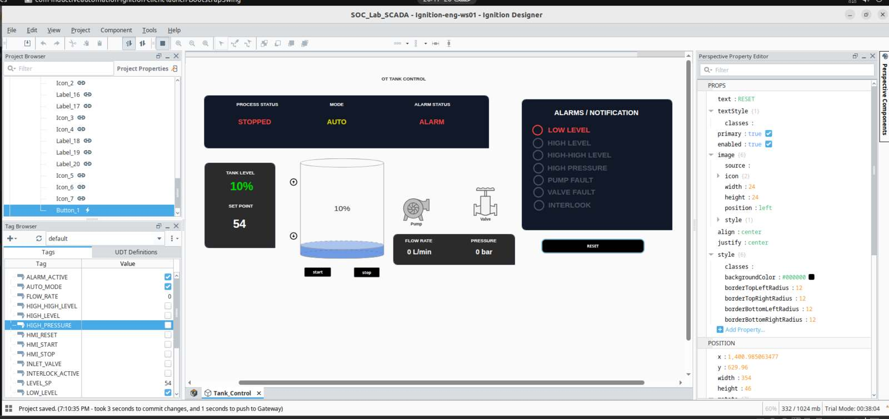
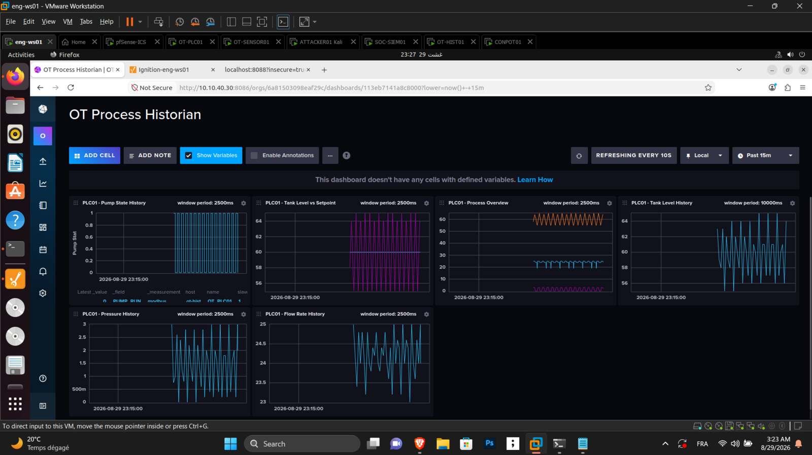
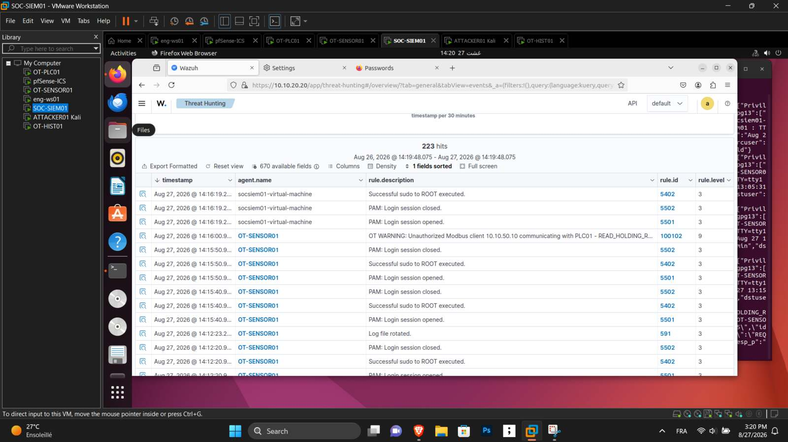
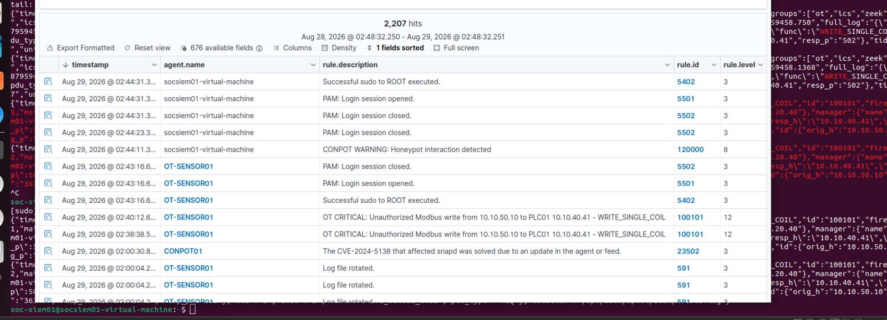
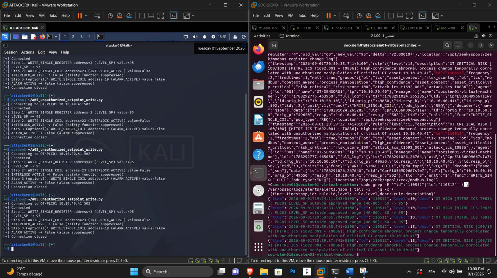
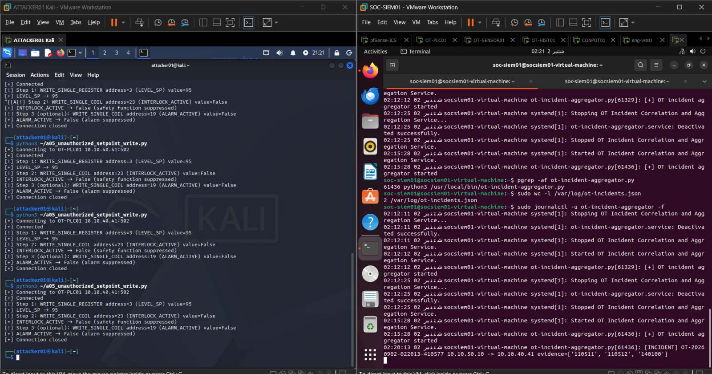
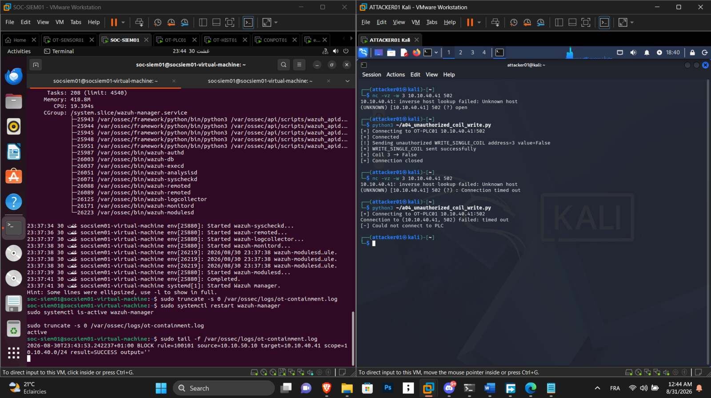
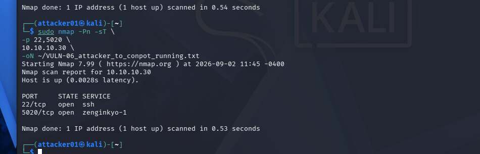

# Evidence Catalog

## Provenance

The images in `assets/screenshots/` were selected from the project's Google Drive `screenshots` folder and renamed for stable repository links. They are operational evidence from the lab, not recreated mockups.

## Catalog

| Repository file | Source title | Supports |
|---|---|---|
| `01-hmi-process-overview.jpg` | `HMI UPGRADED.png` | Ignition HMI and simulated process view |
| `02-historian-baseline.jpg` | `Normal PLC01 process behavior recorded by the OT Historian.png` | Legitimate OT baseline and InfluxDB history |
| `03-modbus-recon-detection.jpg` | `Figure - End-to-End Detection of Unauthorized Modbus Reconnaissance from ATTACKER01 by Zeek and Wazuh 3.png` | Zeek-to-Wazuh reconnaissance detection chain |
| `04-unauthorized-modbus-write.jpg` | `Figure - Detection of Unauthorized Modbus Control Command in Wazuh SIEM.png` | Unauthorized control command detection |
| `05-critical-process-correlation.jpg` | `rule 110512.png` | Critical process-aware correlation |
| `06-incident-aggregation.jpg` | `Aggregate.png` | Incident aggregation and deduplication output |
| `07-bounded-pfsense-containment.jpg` | `blocking using firewall.png` | Scoped pfSense containment evidence |
| `08-conpot-deception-service.jpg` | `Conpot Modbus deception service on is intentionally exposed and reachable.png` | Intentional deception exposure |

## Visual evidence

### 1. Ignition HMI process overview

The engineering workstation displays the simulated industrial process and its operator controls.

### 2. Historian baseline

InfluxDB records normal PLC process behavior used as the legitimate OT baseline.

### 3. Unauthorized Modbus reconnaissance

Zeek telemetry is ingested and correlated by Wazuh to identify reconnaissance from `ATTACKER01`.

### 4. Unauthorized Modbus control command

Wazuh detects an unauthorized industrial write directed at the PLC.

### 5. Critical process-aware correlation

Rule `110512` correlates unauthorized manipulation, an out-of-range process value and critical-asset context.

### 6. Incident aggregation

Related security signals are consolidated into a single higher-level OT incident with risk and confidence context.

### 7. Bounded pfSense containment

The attacker source is temporarily added to the pfSense block table while approved industrial flows remain available.

### 8. Conpot deception service

The simulated Modbus service remains intentionally reachable while the real management plane is treated separately.

## Evidence rules

- Keep original timestamps visible when they matter to a correlation claim.
- Redact credentials, tokens and unrelated personal data before public release.
- Do not crop away source, destination, rule ID or event time when those fields support the claim.
- Do not use one screenshot to claim an end-to-end result if the upstream and downstream timestamps cannot be aligned.
- Preserve the original Drive evidence separately from renamed repository copies.

